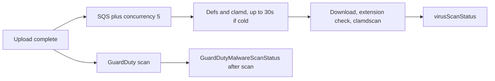

# GuardDuty vs ClamAV: time-to-tag for attachment uploads

**Ticket:** [OY2-42833](https://jiraent.cms.gov/browse/OY2-42833)

**Status:** Assessment only. No cutover is approved.

The goal is a faster clean or not-clean mark on uploaded attachments. GuardDuty Malware Protection for S3 is likely to tag document-sized uploads faster when the ClamAV scanner is cold or when more than five scans are already running. It is not a guaranteed speedup for a single file on an already-warm scanner, and AWS publishes no scan-time SLA.

## Current contract

Downloads stay denied until the object tag `virusScanStatus` is `CLEAN`. The ClamAV role is the only exception, because the scanner must read the object before the tag exists. That policy is in [`lib/stacks/uploads.ts`](../../lib/stacks/uploads.ts).

The scanner is [`ClamScanScanner`](../../lib/local-constructs/clamav-scanning/index.ts). The tag is written at the end of one Lambda invocation in [`scan.ts`](../../lib/local-constructs/clamav-scanning/src/handlers/scan.ts) and [`s3.ts`](../../lib/local-constructs/clamav-scanning/src/lib/s3.ts). `virusScanTimestamp` is written in that same call.

The path before the tag, in order:

1. S3 `ObjectCreated` to SQS.
2. Definition download when `/tmp` is empty.
3. `clamd` startup.
4. Full object download.
5. Extension and content-type check.
6. `clamdscan`.
7. `PutObjectTagging`.

Delays that are in the code today:

- [`startClamd`](../../lib/local-constructs/clamav-scanning/src/lib/clamd.ts) waits up to 30 seconds when the socket is missing.
- Reserved concurrency is 5 and batch size is 1. A sixth simultaneous upload waits in SQS. The function timeout is 3 minutes. The queue visibility timeout is 4 minutes.
- The keepalive rule runs every 2 minutes except 07:00–07:59 UTC and invokes a single execution. It does not keep all five environments warm. A cold Docker image start is additional time on top of the 30-second `clamd` wait, and it was not measured in this review.
- On a warm environment the definition download and `clamd` start are skipped. A single small file can then fall in the same few-second band as the GuardDuty measurements below. That case was not measured here either.
- Objects over 300 MiB are tagged `TOOBIG` without a signature scan. `MAX_FILE_SIZE` is `314572800` in [`constants.ts`](../../lib/local-constructs/clamav-scanning/src/lib/constants.ts).
- `EXTMISMATCH` and `UKNOWNEXT` come from the extension check in the same function. GuardDuty does not produce those results.

## What GuardDuty does

GuardDuty writes `GuardDutyMalwareScanStatus` only after the scan finishes. There is no faster tagging path separate from the scan. Tag values are `NO_THREATS_FOUND`, `THREATS_FOUND`, `UNSUPPORTED`, `ACCESS_DENIED`, and `FAILED`. The [quotas page](https://docs.aws.amazon.com/guardduty/latest/ug/malware-protection-s3-quotas-guardduty.html) and the [how-it-works page](https://docs.aws.amazon.com/guardduty/latest/ug/how-malware-protection-for-s3-gdu-works.html) give no duration. A [re:Post report](https://repost.aws/questions/QU5XvTMGS9RTm--ibgI0etog/s3-malware-scanning-performance-guidelines-and-sla-large-file-upload-delays) says AWS Support confirmed there is no SLA. This account's ClamAV durations were not measured in this review.

`UNSUPPORTED` collapses password-protected files, quota limits, and unsupported features into one tag value. The reason is on the [EventBridge scan-result event](https://docs.aws.amazon.com/guardduty/latest/ug/monitor-with-eventbridge-s3-malware-protection.html). That event can also set `s3Throttled: true` when S3 delayed the read. Delivery is at-least-once. There is no `virusScanTimestamp` on the GuardDuty tag.

## Published timing

Independent tests, each mostly a single trial, timed upload `LastModified` to the scan-complete signal. They are not measurements from this account, and they disagree at 1 GB.

- June 2024, [DevelopersIO](https://dev.classmethod.jp/articles/202406-guardduty-s3-malware-protection-speed-01/): about 2–4 seconds at or below 10 MB, about 7 seconds at 100 MB, about 18 seconds at 500 MB, about 25 seconds at 1 GB.
- August 2026, [Serverworks](https://blog.serverworks.co.jp/2026/08/05/095515): under about 1 second at or below 1 MB, about 2–3 seconds at 10 MB, about 2 minutes at 1 GB, about 9 minutes at 5 GB, about 17–19 minutes at 10 GB. Above 1 GB they observed roughly 8–10 MB/s. The same post says the official docs give no duration.

For this bucket the relevant range is at or below 300 MiB. In that range the published measurements are seconds for small documents and, in the 2024 test, under a minute at a few hundred megabytes.

## Will the tag show up faster?

- Cold scanner, or a burst of more than five uploads: GuardDuty is the faster design. The customer-side path has no 10 GB image start, no 30-second `clamd` wait, and no concurrency cap of five. Small-file measurements are a few seconds.
- One small document on an already-warm scanner: the two are in the same range. A switch can fail to move the number users see.
- Files near 300 MiB: the 2024 test is on the order of tens of seconds, with wide disagreement once files reach about 1 GB. That is still inside the current 3-minute Lambda timeout, so GuardDuty is not automatically faster there.
- The download gate does not get faster if the extension check stays in front of `virusScanStatus=CLEAN`. Today that check is sequential inside the same function. GuardDuty does not perform it.

## Approach

1. Baseline this account before any cutover. Compare object `LastModified` with `virusScanTimestamp` for a warm single file, a cold start (including the 07:00 UTC hour), and a burst above five. Split the Lambda duration into definition download, `clamd` start, download, extension check, and `clamdscan`.
2. If the baseline is dominated by cold start or by the queue behind five executions, use GuardDuty for the signature scan. Keep the extension and size checks, and run them at the same time as the GuardDuty scan. Write `CLEAN` only when both have succeeded. Time-to-tag is then the slower branch. Putting the extension check after GuardDuty, or before it, adds the times.
3. If the baseline is already a few seconds for the uploads that matter, leave ClamAV in place. The remaining lever is the cold start and the cap of five: a warm environment for each slot, and a higher concurrency if bursts are the complaint. That keeps the current tag key. It still costs 10 GB of Lambda memory.
4. Judge a pilot on upload-to-`CLEAN` latency, not on when GuardDuty's own tag appears. `NO_THREATS_FOUND` can land first and still leave the object blocked until the extension result is folded into `virusScanStatus`.

## Constraints that still apply

- Tag key and values differ. Missing tags, `FAILED`, `ACCESS_DENIED`, and `UNSUPPORTED` must stay non-downloadable.
- A GuardDuty role has to be allowed to read the object before a clean tag exists. Application roles must not receive that exception.
- Quotas that do not apply today: 100 GB maximum object, 25 protected buckets per account per Region, and at most five prefixes. Objects outside the prefix never receive a tag.
- The attachments bucket is versioned, so each new version is a separate scan. GuardDuty cannot add its tag if the object already has 10 tags. The event is still published.
- Confirm Malware Protection for S3 is inside this account's authorization boundary before any pilot. Object bytes are read on an AWS-managed scan path.
- Cost shifts from resident 10 GB Lambda memory to a Regional per-GB charge plus a per-1,000-object charge, plus S3 request and optional tagging fees. The published free tier is 1,000 requests and 1 GB per account per Region per month, and it does not cover on-demand scans of existing objects. Confirm the current Regional list price. No account bill was calculated.

## Done when

- This account's upload-to-tag latency is measured for a warm file, a cold start, and a burst of more than five uploads.
- A decision is recorded: pilot GuardDuty for the signature scan, or keep ClamAV and address cold start and concurrency.
- Any pilot is judged on time until `virusScanStatus` is `CLEAN`.

## Open questions

- What are this account's p50 and p95 times from upload to `virusScanTimestamp`?
- Do slow uploads happen on cold starts, during bursts, or in the 07:00 UTC keepalive gap?
- Does `CLEAN` still require the extension and content-type check?
- Is GuardDuty Malware Protection for S3 approved for this account and data classification?
- How does the current 10 GB Lambda cost compare with the current Regional GuardDuty list price at this bucket's object count and bytes?

## Sources

- [How Malware Protection for S3 works](https://docs.aws.amazon.com/guardduty/latest/ug/how-malware-protection-for-s3-gdu-works.html)
- [Quotas](https://docs.aws.amazon.com/guardduty/latest/ug/malware-protection-s3-quotas-guardduty.html)
- [EventBridge scan result](https://docs.aws.amazon.com/guardduty/latest/ug/monitor-with-eventbridge-s3-malware-protection.html)
- [DevelopersIO timing, 2024-06-21](https://dev.classmethod.jp/articles/202406-guardduty-s3-malware-protection-speed-01/)
- [Serverworks timing, 2026-08-05](https://blog.serverworks.co.jp/2026/08/05/095515)
- [re:Post on the missing SLA](https://repost.aws/questions/QU5XvTMGS9RTm--ibgI0etog/s3-malware-scanning-performance-guidelines-and-sla-large-file-upload-delays)
